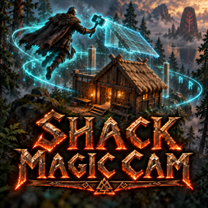

# Shack Magic Cam

**[Download on Thunderstore](https://thunderstore.io/c/valheim/p/TheShackDev/Shack_Magic_Cam/)** · version 1.0.0 · part of [The Shack Pack](https://thunderstore.io/c/valheim/p/TheShackDev/The_Shack_Pack/)

The Shack's build camera. Float the camera away from your Viking and build from above, without climbing on things.

## How to use it

1. Stand near a **workbench** (or any build station: forge, stonecutter, artisan table...).
2. Hold a **hammer**, **hoe** or **cultivator**.
3. Press **Y**. The camera detaches, and "Entering Build Mode." shows top left.
4. Fly with **WASD**, go up with **Jump** and down with **Crouch**, and hold **Run** to go faster. Look around with the mouse.
5. Build, repair and remove pieces as usual, from wherever the camera is.
6. Press **Y** again to go back to your Viking.

- The camera can fly up to **100 m** from the build station you started at (a setting), and you can build anywhere it reaches. Pieces that need a forge or stonecutter count one within that distance too.
- The hotbar keys (1-8) and Hide work while the camera is out.
- **Build mode ends on its own** if you put the tool away, take a portal, die or log out.
- **Picking up items with the camera** works within 2 m of the camera (the base game's range), but only while you're **cozy**: rested, or near a fire and under a roof (or sitting), and not wet, cold or noticed by enemies. Otherwise a small panel says so.
- A **Wisplight** follows the camera and clears mist around it at its normal range. A **Dvergr circlet** light moves to the camera too.
- Works with a controller.

## Settings

Synced settings come from the server when the server has this mod, and only admins can change them. They include build distance, camera range and speed, pickup range, the cozy rule, and the Wisplight and circlet light. Each player keeps their own **toggle key**, look inversion, light position and message position.

The config file is `BepInEx/config/theshack.magiccam.cfg`.

## Multiplayer

- Players without the mod can still join a server that has it. A player with an incompatible version (different major or minor) is told to update.
- If **Cartur's Build Camera** or Azumatt's **Build Camera** is still installed, Shack Magic Cam switches it off and runs the camera itself. You can remove the old one.

## Credits and license

Shack Magic Cam is a fork of [Cartur's Build Camera](https://github.com/jekkle/cartur-build-camera) by Cartur (jekkle). That mod forked Azumatt's Build Camera Custom Hammers Edition, which forked gittywithexcitement's and CookieMilk's Valheim Build Camera. Thank you all.

Like all of them, it is licensed under the **GNU GPL v3.0**: see `LICENSE.txt`. The complete source code is included in this package as `source.zip`.

What changed from Cartur's Build Camera 1.1.1:
- Jotunn handles the settings sync and the version check, instead of a bundled ServerSync and a hand-written handshake.
- The defaults are The Shack's settings: **Y** toggles, 2 m pickup range and 1x Wisplight range (both the base game's values).
- It takes over from the older build cameras instead of running alongside them.

## Building from source

You need the [.NET SDK](https://dotnet.microsoft.com/download) (6.0 or newer) and Valheim. The project compiles against your own copies of the game's DLLs and BepInEx and Jotunn; none of them are in this repo.

```bash
dotnet build -c Release \
  -p:ValheimManaged="/path/to/Valheim/valheim_Data/Managed" \
  -p:ProfileRoot="/path/to/your/profile/BepInEx"
```

`ProfileRoot` is the `BepInEx` folder of any r2modman profile that has Jotunn (it needs `core/` and `plugins/ValheimModding-Jotunn/`). Without the `-p:` options the project looks for a Linux Steam install and an r2modman profile named "The Shack Next". The DLL lands in `bin/Release/`.

This is the source of version 1.0.0 on Thunderstore.
